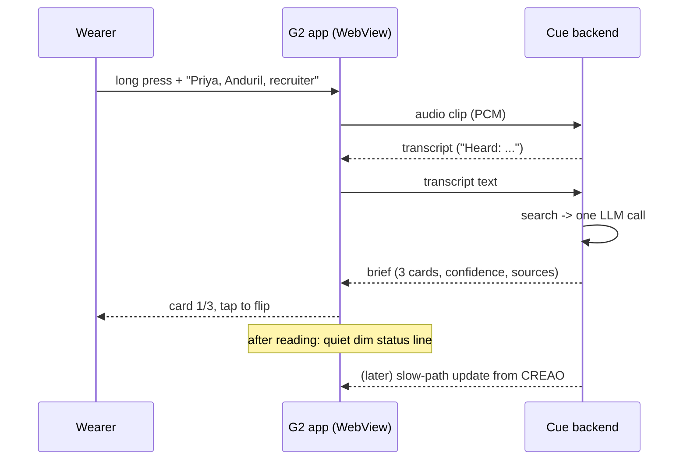

# 00 - Product Spec: Cue

Status: draft, Sat Oct 17 2026 (LA Hacks Fall 2026). Owner: both teammates. Readers: teammates and coding agents.

## Summary

Cue is an app for Even Realities G2 smart glasses that gives quiet networking help at in-person events like career fairs, conferences, mixers, hackathon sponsor tables, and alumni nights. When you meet someone, you hold push-to-talk and quietly say their name, org, and role, for example "Priya, Anduril, recruiter". Within seconds, three short cards appear in your line of sight. One gives you something to connect on, one tells you who they are, and one tells you what to ask for given your goal for the event. Then the display goes quiet so you can actually talk. Cue uses only public, professional information. It has no camera, does no face recognition, and does not record conversations.

## Who it's for

- **Primary:** students and early-career people at events where the conversations matter, such as career fairs, sponsor tables, and alumni mixers. They meet many people in a short time and forget who does what.
- **Secondary:** anyone at a conference or mixer with a clear goal, such as finding a cofounder, teammates, sponsors, or a mentor, or learning from experts.
- **The wearer sets up two things ahead of time:**
  - A **profile**: resume or background text.
  - A **goal** for each event (see "Event goals").

## The live moment (primary focus this weekend)

This is the only flow that must work end to end at the demo.

### Step-by-step flow

1. **Before the conversation.** The wearer reads a name badge or hears an introduction.
2. **Capture.** The wearer holds the temple touchpad (long press) and quietly says "Priya, Anduril, recruiter". Releasing the press ends capture.
   - Fallback input: a single tap toggles capture on and off (`tapToggle` mode in 02), or a "Talk" item in the contextual menu. The reason is that long press may not reliably reach the app on hardware (Unverified, see the G2 facts). Double-click is never used for capture, because it is reserved for the exit dialog.
3. **Listening state.** The HUD shows `● Listening`, then `Looking up...` with `Heard: Priya | Anduril | recruiter` once the transcript is back (exact text in 02).
4. **Brief appears.** Within a few seconds the HUD shows card 1 of 3. A header line shows the name, the org, and the card position (`1/3`).
5. **Flip cards.** Swiping or tapping moves to the next card. Swiping up goes back.
6. **Confirm the person (only if the match is uncertain).** The HUD shows `Which Priya?` with up to 3 candidates plus `Neither (company only)`. Swipe to move, tap to pick. Picking a person shows the full brief. If the person is not confirmed, Cue shows only the org card and says so.
7. **Conversation.** After the wearer finishes reading, or after a timeout (default 25 s, tunable), the display goes **quiet**. A dim status line remains, for example `cue | Priya Raman | hold to ask`. The screen is never fully black, because Even review rules forbid a black screen.
8. **Background update (optional).** If the slow path (CREAO agents) finds better information later, Cue marks the brief as updated with a dim `updated` marker. It does not pop new content over an active conversation.
9. **Exit.** Double-clicking on the root page opens the system exit dialog. This is required by Even review.

### Speed targets

- **Fast path:** STT, then search, then one fast LLM call to write the cards. The target is cards on screen in **under 5 s** from release. This target is Unverified until we measure on the venue wifi.
- **Org-only card:** if the org is preloaded, show it in **under 2 s** while person research continues.
- **Slow path:** CREAO runs take minutes. This path is never on the critical path.

## The three cards

### HUD constraints

- The HUD is 576x288, monochrome green, and uses one fixed font.
- There is no bold, no font size, and no emoji.
- Each card is short enough to read in a glance.

| Rule | Value |
|---|---|
| Header line | `1/3 CONNECT | Priya Raman` (format in 02) |
| Card body | at most 200 characters, at most 5 lines of ~40 characters |
| Source line | last line, dim, e.g. `src: anduril.com/blog` |
| Bullets | use `-` or `●` (box and shape glyphs render; emoji do not) |

### Card 1: Connect

**Purpose:** give the wearer an opening line that is not small talk.

Use the first of these that applies:
1. A **past conversation** with this person, if memory exists. This is a later phase.
2. **Shared background** with the wearer's profile, such as the same school, past employer, club, language, or hometown city at the school or work level only.
3. **Shared interest**, such as a technology, field, or project area found in both.
4. **A question about their own work**, such as a talk, post, project, or paper they made.

**Fallback (person matched, but no overlap with the wearer and no work of theirs found):** offer a question about the org's current work, taken from the preloaded org info. For example: `Ask what their team is building around <product>`. If the person is not matched at all, there is no Connect card (see Confidence rules).

### Card 2: Context

**Purpose:** who they are and what they and their org are focused on now.

- Their role and team, if known, plus one or two recent public items (a talk, post, or project).
- The org's current focus: product, recent news, hiring areas (from the preloaded event data).

**Fallback:** if nothing is found about the person, show only the org context and print `No public info found for <name>` on the first line. Never guess the person's role or history.

### Card 3: Your angle

**Purpose:** how this conversation serves the wearer's event goal, and the specific ask.

- One line linking the wearer's profile to the person or org, for example `Your robotics club work maps to their autonomy team`.
- One concrete ask, for example `Ask: is the fall SWE intern req still open?`.
- This card changes when the goal changes. The other two cards may stay the same.

**Fallback:** if neither the person nor the org is known, show a generic ask for the goal, for example `Ask what they look for in interns`.

### Confidence rules

| Situation | What the wearer sees |
|---|---|
| Strong match: results mention both name and org | All 3 cards, with source lines |
| Uncertain: name partly matches, or several candidates | A confirm prompt first. Full brief after a tap. If not confirmed, the org card only |
| No person match | Org card only, plus `No public info found for <name>` |
| Org unknown and person unknown | Card 3 with a generic goal-based ask, labeled `Low info` |
| STT unsure of name | The `Heard: Pria | Andrill` line shows while searching; hold again to re-ask |

## Event goals

The wearer picks one goal per event. They can switch it on the setup page, or from the contextual menu on the glasses with an item such as `Goal: Cofounder`. The goal mostly changes card 3.

| Event type | Typical goal | What card 3 focuses on | Example ask |
|---|---|---|---|
| Career fair | Internship / job | Fit between the wearer's resume and the org's open roles | "Which teams are hiring interns for summer?" |
| Mixer | Find a cofounder | Shared problem space, complementary skills | "What are you building next? Looking for a technical partner?" |
| Conference | Learn from experts | A specific question about their talk or work | "How did you handle X in your talk's system?" |
| Hackathon (sponsor tables) | Teammates / sponsors | How the wearer's project uses the sponsor's tool, prizes | "What would make a submission stand out for your track?" |
| Alumni event | Mentorship | Shared path (school, major, first job), advice to ask for | "What would you do differently in your first year at <org>?" |

**Demo beat:** switch the goal from Internship to Cofounder with the same person. Card 3 changes and cards 1-2 stay.

## Before and after (later phases)

These features are not required for the demo. Build them only after the live moment is solid.

| Phase | Feature | Status this weekend |
|---|---|---|
| Before | **Load the event**: import an employer list, speaker list, or Luma guest list so org info is preloaded. This is a small store with exact org lookup plus the wearer's profile. | **Needed in minimal form**: we preload the demo event with the CREAO Event Loader (hand-written org records only as an emergency fallback, since CREAO must be load-bearing). This is what makes org-only cards fast |
| Before | Profile and goal setup on the setup page (laptop browser, served by the backend) | Minimal: paste resume text, pick a goal |
| After | Follow-up draft sent to the wearer via Photon iMessage | Later, optional. Unverified: whether Photon can send a first message without an inbound one |
| After | Memory of past conversations (feeds card 1) | Later, optional |
| After | End-of-event summary of who you met and asks to follow up | Later, optional |

**Cut order if behind:** Photon, then Sentry, then the MLH extras. Never cut G2 or CREAO.

## Non-goals

- **No face recognition.** G2 has no camera. Identity comes only from what the wearer says.
- **No recording of conversations.** Audio is captured only while push-to-talk is held. It is discarded after transcription and never stored.
- **No scheduled-meeting prep.** Cue is for the walk-up moment, not calendar meetings.
- **LinkedIn: professional sections only.** Decided Oct 18 for the hackathon: the Researcher may read a profile's headline, role, experience, projects and publications. Contact info, connections, activity and anything personal in About are never used. `ALLOW_LINKEDIN=0` restores the full block.
- No ambient or always-on listening.
- No covert use. Cue helps you remember and prepare. It is not a way to pretend you know someone.

## Privacy and source rules

The brief writer and every agent must follow these rules. We enforce them in code where possible, not only in prompts.

**Allowed sources (public, professional, ideally self-published):**
- Talks, podcasts, and interviews
- Their own posts, blogs, personal site, or GitHub
- Articles about them in a professional context
- School, team, and company pages
- Search result titles and snippets, including LinkedIn headlines shown in results

**Never use or display:**
- Family, home address, health, politics, religion, or other personal life
- Anything from a login-gated page
- LinkedIn contact info, connections, activity, photos, and personal lines in About.

**Disambiguation:**
- Keep a result only if its title or text mentions **both** the name and the org.
- Every person-specific claim must carry a source.
- The card shows the source domain on its last line.
- If sources conflict, prefer the self-published one, and lower the confidence.

**Data handling:**
- Audio is discarded after STT.
- The brief (cards, sources, transcript text) is kept on our backend for the event, so slow-path updates and goal switching work, and on the wearer's device (localStorage). Delete backend briefs after the event. Audio is never stored anywhere.
- API keys live only on the backend proxy, never in the glasses app.
- The privacy policy must cover the microphone and network permissions and list the backend domains. This is required for Even review.

**Demo consent:** we use the brief on the demo person only with their consent, and they have a public bio.

## Success criteria for the demo

The demo passes if all of these are true:

1. **Runs on physical G2 hardware** from an Even Hub build, mirrored to a laptop for judges. Unverified: whether a Private build is enough or a Beta build is required. Ask at the 3-4 PM workshop.
2. **Live moment works end to end.** A teammate reads a consenting sponsor rep's badge and says the name, org, and role. Cards appear in **under ~5 s** with real web-search results and a source line.
3. **Three cards flip** with taps or swipes. The text is readable and fits without overflow.
4. **Quiet mode.** During the conversation the HUD shows only a dim status line. The screen is never black.
5. **Goal switch.** Switching to Cofounder changes card 3 visibly for the same person.
6. **Honest fallback.** One lookup with an unknown name shows the org-only card with "No public info found".
7. **CREAO is load-bearing and visible.** The Event Loader preloaded the event, and a Person Researcher run is shown running or completed. The README has the agent run share link and the agent ID. Unverified: which share link format the judges expect.
8. **Review-rule hygiene:**
   - A first-launch on-glasses instructions screen.
   - Double-click shows the exit dialog.
   - A clean console at boot.

**Honesty line for the pitch:** "Person lookup is real web search. We preloaded the demo event with people who have public bios."

## Open questions

- Does the track require a Beta build, or does a Private build suffice? (Ask at the workshop.)
- Does a plain long press reach the app reliably on hardware? (Test early. Fallbacks are designed in.)
- What is the real end-to-end latency on venue wifi for STT, search, and LLM?
- What is the submission deadline? (Believed to be Sun ~12:00, unconfirmed.)
- How long should the auto-quiet timeout be? Is the reading time enough on hardware?
