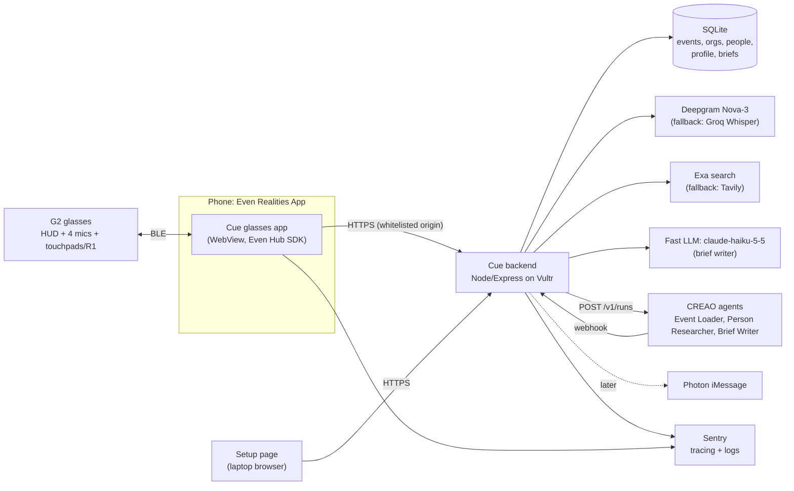
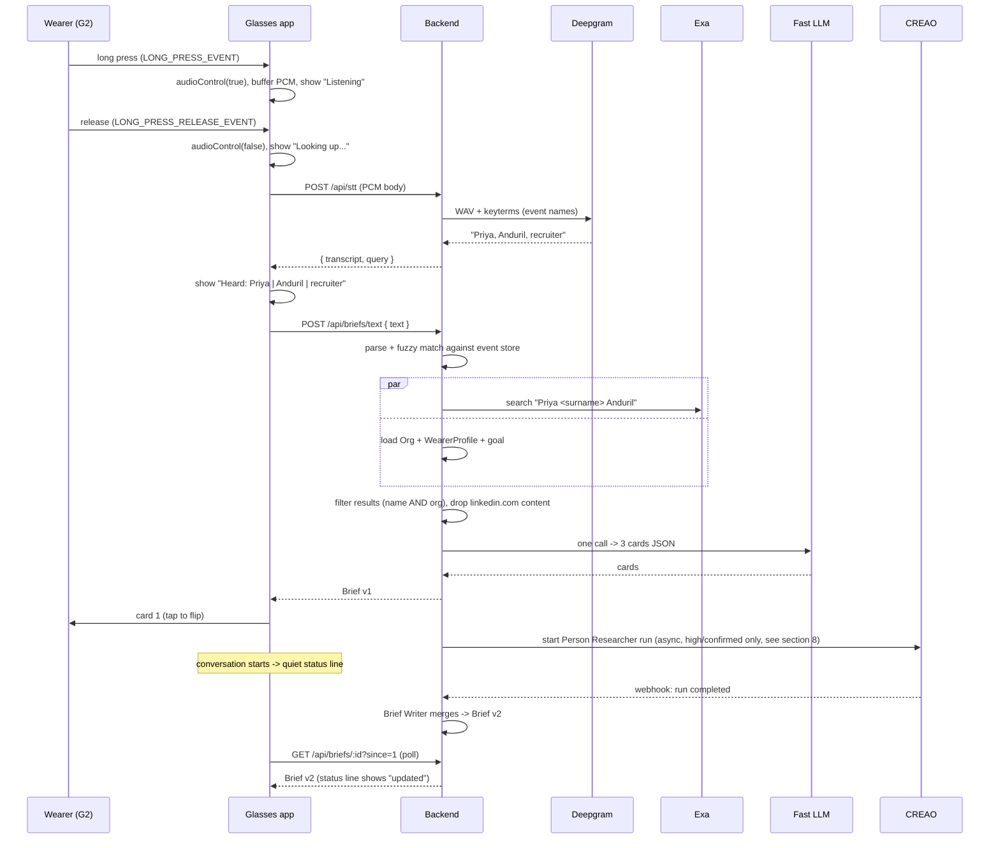

# 01 - System Architecture

Status: draft, Sat Oct 17 2026. Owners: both teammates. Readers: teammates and coding agents.

## 1. Overview

Cue has three parts.

1. **Glasses app.** A TypeScript web app (Vite, vanilla TS) that runs in the Even Realities phone app WebView and draws on the G2 using the Even Hub SDK. It captures push-to-talk audio, sends it to our backend, and renders three cards. It holds **no API keys**.
2. **Backend.** One Node/Express server on Vultr. It owns every secret and does the work: speech-to-text, store lookup, web search, the fast LLM call, CREAO runs, and (later) Photon.
3. **Third-party services.** Deepgram (STT), Exa (search), a fast LLM (Claude Haiku 5.5, `claude-haiku-5-5`, set by `BRIEF_MODEL`), CREAO agents, Sentry, and later Photon.

There are two paths:

- **Fast path (seconds):** audio -> STT -> parse -> store lookup + Exa -> one LLM call -> cards. This must work without CREAO.
- **Slow path (minutes):** CREAO agents research more deeply in the background. When a run finishes, the backend updates the brief and the glasses app picks up the new version.

CREAO also does the "load the event" job the night before. That data is what makes the fast path fast, which is why CREAO is load-bearing for the product and not a side feature.

## 2. Component diagram



The **setup page** is a plain web page served by the backend, used on a laptop to paste the wearer profile, pick the goal, and load the event. Typing a resume on the glasses is not realistic.

## 3. Live path

### 3.1 Sequence



### 3.2 Latency budget

Product target (00): **under 5 s** from button release to card 1 on the HUD. This budget aims for about 4 s to leave headroom. Every number below is Unverified until measured on venue wifi and real hardware.

| Step | Budget | Notes |
|---|---|---|
| Stop audio, wrap PCM, upload (~3 s clip = ~96 KB) | 300 ms | Phone to Vultr over wifi. BLE streaming happens during the hold, so it is not on this clock. Unverified: whether BLE delivers 32 KB/s of PCM in real time; if audio lags, the tail arrives after release. |
| Deepgram pre-recorded STT | 700 ms | Unverified. Groq fallback similar. |
| `/api/stt` response, then `POST /api/briefs/text` | 150 ms | Extra round trip so the HUD can echo `Heard:` early. |
| Parse + store lookup | 50 ms | Local SQLite. |
| Exa `fast` search with highlights | 800 ms | Unverified. Try `instant` if too slow. |
| Fast LLM call, cards JSON | 1500 ms | `claude-haiku-5-5` (env `BRIEF_MODEL`), `output_config.effort: "low"`, JSON via structured outputs. Small prompt, short output. |
| Response to phone + `textContainerUpgrade` | 300 ms | BLE render time Unverified. |
| **Total** | **~3.8 s** | |

If over budget: show the **org card from the store first** (it needs no search or LLM), then upgrade to the full brief. See section 7.

## 4. Glasses app to backend API

All calls are HTTPS to one origin (for example `https://api.cue.<domain>`), which is the only entry in the app.json `network` whitelist. The backend sets CORS headers for the WebView. The backend is single-tenant for the weekend: one wearer, one profile, one active event. Auth is one bearer token (`Authorization: Bearer <deviceToken>`) that the backend reads from `DEVICE_TOKEN` and the app gets at build time from `VITE_DEVICE_TOKEN`. The setup page asks for the same token once and keeps it in its own localStorage. This is not a third-party API key, but it is extractable from the .ehpk, so the backend rate-limits lookups and we rotate the token after the event.

We use **REST plus polling**, not WebSockets, because WebSockets drop when the WebView backgrounds and polling recovers on its own.

### 4.1 Endpoints

| Method | Path | Caller | Purpose |
|---|---|---|---|
| GET | `/api/state` | glasses | Active event, goal, profile summary, and the event's orgs (cached for offline cards). Called on launch. |
| POST | `/api/stt` | glasses | Audio in, `{ transcript, query }` out. |
| POST | `/api/briefs/text` | glasses, setup page | Text in, Brief out (fast path). The glasses send the `/api/stt` transcript; the setup page sends typed text (demo fallback). |
| GET | `/api/briefs/:id?since=<version>` | glasses | Poll for slow-path updates. `304` if nothing new. |
| POST | `/api/briefs/:id/confirm` | glasses | Wearer confirms or rejects the person match. |
| PUT | `/api/goal` | glasses, setup page | Switch goal. Returns regenerated card 3 for the open brief. |
| PUT | `/api/profile` | setup page | Save wearer profile. |
| POST | `/api/events` | setup page | Create event and start CREAO Event Loader. |
| GET | `/api/events/:id` | setup page | Load status and counts. |
| POST | `/webhooks/creao` | CREAO | Run completion. |
| POST | `/api/mirror` | glasses | Optional. Latest `Screen` (02 section 2), fire-and-forget, for the laptop mirror. |
| GET | `/mirror` | laptop | Optional. Page that polls the latest `Screen` every 500 ms and draws it. |

### 4.2 Shapes

`POST /api/stt`

- Headers: `Content-Type: application/octet-stream`, `X-Audio-Format: pcm_s16le;rate=16000;channels=1`.
- Body: raw PCM bytes. The backend adds the 44-byte WAV header.
- Response `200`: `{ "transcript": "Priya, Anduril, recruiter", "query": { "name": "Priya", "org": "Anduril", "role": "recruiter" } }`. Empty transcript returns `STT_EMPTY`.

`POST /api/briefs/text` body: `{ "text": "Priya, Anduril, recruiter" }`. The backend re-parses the text (same parser as `/api/stt`).

Response `200`:

```json
{
  "brief": {
    "id": "brf_01J...",
    "version": 1,
    "transcript": "Priya, Anduril, recruiter",
    "query": { "name": "Priya", "org": "Anduril", "role": "recruiter" },
    "match": { "personId": "per_123", "confidence": "high", "candidates": [] },
    "cards": [
      { "kind": "connect", "title": "Connect", "body": "Both of you ...", "source": "anduril.com/blog" },
      { "kind": "context", "title": "Context", "body": "Recruits for ...", "source": "youtube.com" },
      { "kind": "angle", "title": "Your angle", "body": "Ask about ...", "source": null }
    ],
    "slowPath": { "status": "running", "runId": "run_abc" }
  }
}
```

Error response (any endpoint): `{ "error": { "code": "STT_EMPTY", "message": "Didn't catch that" } }`. Codes: `STT_EMPTY`, `STT_FAILED`, `NO_EVENT`, `SEARCH_FAILED`, `LLM_FAILED`, `UNAUTHORIZED`.

`POST /api/briefs/:id/confirm` body: `{ "personId": "per_123" }` or `{ "personId": null }` (none of these). Returns the updated brief, version+1. If `personId` is `candidates[0]` (the one the cards were written for), only `match.confidence` becomes `high`. If it is another candidate, the backend rewrites all 3 cards for that person (one LLM call, no new search). If `null`, the brief becomes org-only (one `context` card). A Person Researcher run starts only after a pick, never for `null`.

`PUT /api/goal` body: `{ "goal": "cofounder", "briefId": "brf_01J..." }`. Returns `{ "goal": "cofounder", "brief": <Brief with new card 3, version+1> }`. `briefId` is optional; without it, only the stored goal changes. Org-only briefs have no card 3 and are returned unchanged.

`GET /api/state` response: `{ "event": Event | null, "goal": Goal, "profile": { "name", "school" }, "orgs": Organization[] }`.

`PUT /api/profile` body: `WearerProfile` without `id`.

`POST /api/events` body: `{ "name", "date", "orgs": string[], "people": [{ "name", "org", "role" }], "sourceText": string }`. Creates the event, makes it active, starts the Event Loader with this input (03 section 3), and returns `{ "event": Event }`.

## 5. Data models

TypeScript types, shared by app and backend in `shared/types.ts`. **These are the canonical types for every doc.** 03's agent output schemas are subsets of them; the backend adds `id`, `eventId`, and server fields. SQLite stores each entity as a row; nested arrays are JSON columns.

```ts
type Goal = "internship" | "cofounder" | "learn" | "teammates_sponsors" | "mentorship";
type Confidence = "high" | "medium" | "low";
type SourceKind = "talk" | "podcast" | "own_post" | "personal_site" | "github"
  | "article" | "school_page" | "team_page" | "org_site" | "search_snippet";

interface Fact {
  text: string;                                     // one sentence, <= 140 chars, professional only
  sourceUrl: string;
  sourceKind: SourceKind;
  date?: string;                                    // ISO date if known
}

interface Event {
  id: string; name: string; date: string;           // ISO date
  sources: { kind: "employers" | "speakers" | "luma" | "url"; raw: string }[];
  loadStatus: "empty" | "loading" | "ready" | "failed";
  creaoRunId?: string;
}

interface Organization {
  id: string;                                       // lowercase slug, e.g. "anduril"
  eventId: string;
  name: string; aliases: string[];                  // "Anduril", "Anduril Industries"
  oneLiner: string;                                 // <= 120 chars, what they do
  focusNow: Fact[];                                 // max 5: launches, priorities, hiring areas
  eventRole?: string;                               // "sponsor table 12", "speaker: 2pm panel"
  hiring?: string;                                  // roles/programs, if public
  people: string[];                                 // known attendee names from the event list
}

interface Person {
  id: string; eventId: string; orgId: string;
  name: string; role?: string;
  headline?: string;                                // from a search title/snippet; LinkedIn headline allowed
  facts: Fact[];                                    // max 8, sorted by source priority (03 section 4)
  match: Confidence; matchReason: string;           // "3 sources mention both name and Anduril"
  lastResearchedAt?: string;
  fromEventList?: boolean;                          // loaded from an event file / event list (a known attendee)
  confirmed?: boolean;                              // the wearer picked them on the Confirm screen
}

interface WearerProfile {
  id: string; name: string;
  school?: string; major?: string;
  resumeText: string;                               // pasted on setup page; not sent to the fast LLM
  summary: string;                                  // 2-3 lines, typed on setup page; sent to the LLM
  interests: string[];
  projects: string[];
  goal: Goal; goalNote?: string;                    // "summer 2027 SWE intern"
  pastConversations?: { personName: string; orgId: string; note: string }[];  // later phase
}

interface Card {
  kind: "connect" | "context" | "angle";
  title: string;                                    // <= 20 chars; laptop mirror only, the HUD header is built by the app (02)
  body: string;                                     // <= 200 chars, <= 5 lines of <= 40 chars
  source: string | null;                            // bare domain/path, <= 34 chars, e.g. "anduril.com/blog"; the app adds "src: ". null only on "angle"
}

interface Brief {
  id: string; version: number; eventId: string;
  transcript: string;
  query: { name: string; org: string; role?: string };
  match: { personId: string | null; confidence: Confidence; candidates: { personId: string; label: string }[] };
  cards: Card[];                                    // high/medium: 3 cards. low or "Neither": only "context" for the org. Org unknown too: only "angle" (generic ask)
  slowPath: { status: "none" | "running" | "done" | "failed"; runId?: string };
  createdAt: string; updatedAt: string;
}
```

Card length limits come from the display: a full-screen text container fits about 400-500 characters, and the cards share the screen with a header and footer line. Final layout is in 02.

**Parsing the transcript**

- Deepgram is called with `model=nova-3`, `smart_format=true` (punctuation), and one `keyterm` per event name.
- If the transcript splits on commas into 2-3 parts, they are name, org, role. Otherwise, find the longest org name or alias from the event store inside the transcript; the words before it are the name and the words after it are the role.

**Lookup rules**

- Org match: exact or alias match on `Organization`, then case-insensitive fuzzy match. The Deepgram keyterm list is built from org names and person names in the active event (top 20-50, under the 500-token limit) plus goal words.
- Name expansion: the wearer often says only a first name. If the store has exactly one Person at that org with that first name, use their full name for search. Otherwise search `"<first name> <org> <role>"` and cap confidence at `medium`.
- Person match (same rule as 03 section 4 and 04 section 8): `high` if a stored Person (on the event list, or confirmed by the wearer; search guesses saved as Person records do not count) matches name and org, or 2+ kept results agree on one person; `medium` if exactly 1 kept result, or kept results name 2+ different full names (fill `candidates`, max 3); `low` if 0. Medium shows the Confirm screen (02). Low shows the org card only, whose body starts with `No public info found for <name>.`
- Search results are kept only if title or text contains both the name and the org (or an alias). The fast path excludes `linkedin.com` at search time (03 section 4); we never fetch LinkedIn contents.

## 6. Secrets, CORS and privacy

- **No keys in the glasses app.** The .ehpk is extractable. All keys (Deepgram, Exa, LLM, CREAO `cr_sk_`, Photon, Sentry auth token) live in backend environment variables on Vultr. The Sentry browser DSN is public by design and may ship in the app.
- **Whitelist and CORS are separate gates.** app.json lists only our backend origin (full `https://host`, no wildcards), so the backend hostname must be final before the Even Hub build (04 A12); changing it means a new .ehpk. The backend answers CORS preflight (`OPTIONS`) for the WebView. Unverified: the exact `Origin` header the Even WebView sends (it will differ between the QR dev server and the packaged build). Because auth is a bearer header and not a cookie, send `Access-Control-Allow-Origin: *` and list `Authorization, Content-Type, X-Audio-Format` explicitly in `Access-Control-Allow-Headers` (a `*` there does not cover `Authorization`). Log the observed `Origin`.
- **CREAO webhook** has no signature. The backend accepts it only if `runId` matches a run it started, dedupes on `X-Creao-Delivery-Id`, replies `200` within 10 s, and does the real work after replying.
- **Audio** is held in memory for the STT call and then discarded. It is never written to disk, logs, or Sentry. Transcripts are stored with the brief.
- **Research scope:** professional and self-published sources only. The LLM prompt forbids family, home, health, and politics, and the backend drops any card that mentions them (keyword check as a backstop).

## 7. Failure handling and fallbacks

| Failure | What the wearer sees | Backend behavior |
|---|---|---|
| Long press does not reach the app (Unverified on hardware) | Same flow via tap toggle (`tapToggle` mode) or menu item "Talk" | None. App supports all three inputs. |
| Empty or garbled transcript | "Didn't catch that. Hold and try again." | `/api/stt` returns `STT_EMPTY`. |
| Deepgram error or timeout (>2 s) | Nothing different | Retry once on Groq Whisper with names in `prompt`. |
| Org not in store | Cards still appear, from search only | Search-only brief; mark confidence at most `medium`. |
| Exa error or timeout (>1.5 s) | Org card from store, "Person lookup unavailable" | Try Tavily `fast` once. |
| LLM error or timeout (>3 s) | Org card from store, built by template, no LLM | Return template brief; slow path may fill in later. |
| Ambiguous person | Confirm screen: `Which Priya?` picker (02) | `candidates` filled, `confidence: medium`. |
| CREAO run fails, rate-limited (429), or out of credits | Nothing; fast brief stays | Mark `slowPath.status: failed`, log to Sentry. |
| Backend unreachable | "Offline. Showing saved event info." | App uses org data cached in localStorage from `/api/state`. |
| WebView suspended (Android) | App relaunches into last brief | App persists current brief id and card index to localStorage; rebuilds page on launch. |

The display is never black. The idle screen and the quiet state both show a dim status line (`textColor` low; level 0 not used until tested on hardware).

## 8. CREAO agents

| Agent | Trigger | Input | Output written to store |
|---|---|---|---|
| Event Loader | `POST /api/events` | `{ eventId, eventName, orgs[], people[], sourceText }` | Organizations and known People |
| Person Researcher | After a fast brief with `high` match, or after the wearer picks a person on Confirm | `{ name, org, role, orgAliases[] }` | Person `facts`, `headline`, `match` |
| Brief Writer | After Person Researcher completes | `{ person, organization, wearer, goal, eventName }` | Brief v2 cards |

Input and output schemas are in 03. All three are started with `POST https://developer.creao.ai/v1/runs` with our `webhook_url` (`<PUBLIC_BASE_URL>/webhooks/creao`), and polled with `GET /v1/runs/{run_id}` every 15 s while pending as a backup (this also covers local dev with no public URL). A run still pending after 15 minutes is marked `failed`. Agent output is asked for as JSON in `result.text`; the backend validates it and ignores runs that do not parse. The 30 requests/minute account limit (polls count) is above our needs, but the backend still queues runs and honors `Retry-After`.

**Credits.** Per-run cost is unknown and the free plan is small, so: at most one Person Researcher run per person per event (skip if `lastResearchedAt` is set), never for `low` matches, and none during rehearsal unless needed. If chained runs are too slow or too costly, the backend may write Brief v2 with the fast LLM from the Person Researcher output; the Event Loader and Person Researcher stay on CREAO.

## 9. Observability (Sentry)

- Backend: tracing with one span per live-path step (stt, lookup, search, llm), so the latency table above is measured, not guessed. Structured logs for CREAO runs and webhooks.
- Glasses app (optional): browser SDK for errors, and a span from button release to first render. Its ingest origin must be added to the app.json `network` whitelist and the privacy policy. Backend tracing plus logs already meet the "2 products beyond errors" bar, so skip the app SDK if time is short. Boot must stay console-clean for Even review.

## 10. Open questions

- Does the track accept a Private build, or is a Beta build required? (Ask at the 3-4 PM workshop.)
- Does a plain long press reach the app on this phone and app version (needs Even App 2.2.9 or newer)?
- Fast LLM: decided, Claude Haiku 5.5 (`claude-haiku-5-5`, env `BRIEF_MODEL`). Still open: which account pays for it.
- Is our CREAO plan able to use the Developer API (`cr_sk_`), and what does a typical run cost in credits?
- What "agent run share link" do CREAO judges want in the README?
- Real latencies on venue wifi for Deepgram and Exa (benchmark 5 calls each).
- Whether to stream PCM to the backend during the hold to cut STT time. Not needed unless the budget is missed.

## 11. Hosting

Status: decided Sat Oct 17 2026. Replaces "Vultr" wherever it appears above.

The backend runs on one AWS Lightsail instance (Ubuntu 24.04, $5/month plan, 1 GB RAM) paid from
the team's AWS credits. Caddy terminates HTTPS on `https://<static-ip>.sslip.io` with an automatic
Let's Encrypt certificate and proxies to the backend on `127.0.0.1:8787`. The backend is a systemd
service (`cue-backend`) that starts on boot and restarts on any exit after 3 s with no start limit,
because the Photon reply listener holds a long-lived connection. Logs are in the journal
(`journalctl -u cue-backend -f`). Secrets live only in `/opt/cue/backend/.env` on the server, a copy
of the local file; beyond `.env.example` it must also carry `DEVICE_TOKEN` (non-empty, so `/api/*`
is gated), `OPENAI_API_KEY` (decision gate), and the Photon keys. The static IP is mandatory: the
hostname encodes it, and the hostname is baked into the app's `app.json` whitelist and
`VITE_BACKEND_URL`, so changing it means a new Even Hub build. The store is in memory, so the event
must be reloaded after a restart. Setup steps and scripts: `deploy/README.md`.
