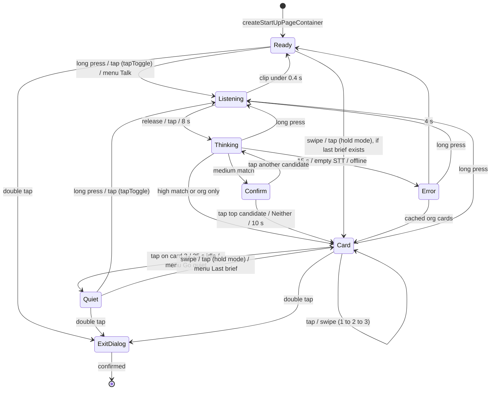

# 02 - Glasses UX (G2)

What the wearer sees on the G2 HUD and what each gesture does, per state. Facts come from the Even Hub docs, the SDK 0.0.16 `.d.ts`, and the hardware test below.

## Measured on hardware (Sat Oct 17, real G2, iOS, Even app 2.3.2)

| Question | Result |
|---|---|
| Long press | Arrives on `sysEvent` as eventType 9; release as eventType 10; `eventSource` R. **`PTT_MODE = "hold"`.** |
| Tap | Arrives on `sysEvent` with eventType `undefined` (protobuf-omitted 0 = CLICK). |
| Swipe up / down | Arrive on `textEvent`, eventType 1 / 2, `containerName: "body"`, even when the body does not overflow. |
| Double tap | Opens the system exit dialog via `shutDownPageContainer(1)` (works). |
| Menu | Tap-then-hold opens our contextual menu (works). |
| Left temple | Works too (gestures from both temples reach the app). |
| Body lines | The old 200 px body showed only about 5-6 lines at once (more needed scrolling), with a cut-off partial line at the top and bottom. Cause: firmware line height is a fixed 27 px (even-pretext), and the old inner heights (44 - 12 = 32 px, 200 - 12 = 188 px) were not multiples of 27. **Fixed geometry below: every inner height is an exact multiple of 27 px; body is exactly 5 lines.** |
| Mic | `audioControl(true)` returns true. 1600 B frames (50 ms) in real time. First frame about 430-460 ms after the long press. 1-2 late frames after `audioControl(false)`. Playback is clear. Peak reaches 1.00 when speaking normally (possible clipping; watch STT accuracy). |
| Network | Phone reaches the laptop backend over the laptop's phone hotspot IP (`http://172.20.10.2:8787`); `GET /api/state` 25 ms. eduroam blocks phone-to-laptop: use the hotspot. |
| Font | Proportional. About 49 digits per line; noticeably fewer `W`s. All tested glyphs render (safe list plus the "unsafe" ones on the ruler page). The section 6 card 2 body renders in 3 lines, so the 200-char / 5 x 40 body budget is safe. |
| Brightness | Readable at `textColor` 2, 3, 4 (against a cloudy sky). Use 3-4 for content and **2 (not 1)** for the quiet status line. |

| New geometry | Verified: no cut-off lines on any card; first and last words intact. |
| Full flow (real STT, `?mock=0`) | Hold, say "Jordan, Sentry, developer advocate", release: transcript correct, cards in about 2 s. Swipes flip cards cleanly. 25 s auto-quiet returns to `cue \| jordan \| hold to ask`. All 9 menu items fit; opening the menu does not start Listening. Listening bar (━/─) renders. |
| Phone page | The Even app shows our WebView (mirrors the HUD) while the app runs. |
| Hot reload | Glasses update after a WebView reload (the `rebuildPageContainer` fallback in `layout.ts` works). |

Not yet verified: level 2 readability under bright venue lights.

## 1. Overview

- **One layout, created once.** Three stacked text containers: header, body, footer. Every state change after startup is a `textContainerUpgrade` (no flicker). We never call `rebuildPageContainer` in the normal flow.
- **Never black.** Every state shows at least one dim line of text.
- **Quiet by default.** After a brief is read, the HUD drops to one dim status line.
- **Three cards per brief:** 1 Connect, 2 Context, 3 Your angle. Tap or swipe to flip.
- **Double tap always opens the system exit dialog.** All states are on the root page, so we treat double tap as exit everywhere (review rule).

## 2. Display budget

| Fact | Value |
|---|---|
| Canvas | 576 x 288 px, 4-bit green, black = transparent |
| Containers | max 8 text/list + 4 image; exactly one `isEventCapture: 1` |
| Text styling | none (no size, bold, align); `\n` works; wraps at width |
| Brightness | `textColor` 0-4 (4 default); 2-4 readable on hardware; use 2 as the dimmest level |
| Full-screen text | about 400-500 characters |
| Char caps | 1000 on create/rebuild, 2000 on upgrade |
| Border radius field | `borderRadius` (correct spelling in the 0.0.16 `.d.ts`; ignore the docs' `borderRdaius` warning) |
| Safe glyphs | ASCII plus `━ ─ █ ▲ ▼ ● ○ ■ □ ★ │ ╭╮╯╰` |

**Line budget (measured):** about 49 digits per line (fewer for wide letters like `W`), so the 40-character budget has headroom. Line height is a fixed 27 px. The body holds exactly 5 lines and card text must never scroll. The font is proportional, so wide letters cost more. The body gets 5 lines. Avoid `·`, `✓`, curly quotes, and emoji (not on the glyph list, may be dropped). Use `|` as a separator.

### Container layout

| ID | `containerName` | x, y, w, h | Capture | Default `textColor` | Purpose |
|---|---|---|---|---|---|
| 1 | `hdr` | 0, 0, 576, 35 | 0 | 3 | Card index, card type, person or org (1 line) |
| 2 | `body` | 0, 44, 576, 143 | **1** | 4 | Card text or state message (5 lines) |
| 3 | `foot` | 0, 253, 576, 35 | 0 | 2 | Source line, hints, status (1 line) |

All use `borderWidth: 0`, `paddingLength: 4`. Inner height = h - 8 = lines x 27 px exactly (hdr/foot 27, body 135), so no partial line can show. Wrap width is 576 - 8 = 568 px. The client measures text with `@evenrealities/pretext` (`measureTextWrap`, `pxTruncate`): hdr/foot are pixel-truncated to one line, and the body is cut at a word (with `...`) so it wraps to at most 5 lines, so the firmware never scrolls it. (Old geometry 44/200/44 with padding 6 showed partial lines on hardware.)

### Render contract (for coding agents)

```ts
type Level = 0 | 1 | 2 | 3 | 4;
interface Screen {
  hdr: string;  hdrLevel: Level;   // <= 40 chars, one line
  body: string; bodyLevel: Level;  // <= 200 chars, <= 5 rendered lines at 568 px
  foot: string; footLevel: Level;  // <= 40 chars, one line
}
// render(next): for each container whose text or level changed,
// await bridge.textContainerUpgrade(new TextContainerUpgrade({
//   containerID, containerName, content, textColor })).
// Send one upgrade at a time. ID and name must match exactly or it silently no-ops.
```

The phone WebView renders the same `Screen` as HTML for the laptop mirror. Unverified: whether the Even app shows our WebView on the phone screen while the glasses app runs. If not, `render()` also sends each `Screen` to `POST /api/mirror` (fire-and-forget) and the laptop opens `/mirror` (01 section 4).

## 3. Inputs

| Gesture | SDK event | Where it arrives |
|---|---|---|
| Tap | `CLICK_EVENT = 0` (arrives as `undefined`; treat both as tap) | `sysEvent` (measured); also accept `textEvent` |
| Double tap | `DOUBLE_CLICK_EVENT = 3` | `textEvent` |
| Swipe up | `SCROLL_TOP_EVENT = 1` | `textEvent` (measured, container `body`) |
| Swipe down | `SCROLL_BOTTOM_EVENT = 2` | `textEvent` (measured, container `body`) |
| Long press / release | `LONG_PRESS_EVENT = 9` / `LONG_PRESS_RELEASE_EVENT = 10` | `sysEvent`, source R (measured) |
| Menu item | `menuItemClickEvent.itemID` | menu |
| Foreground enter / exit | `FOREGROUND_ENTER_EVENT = 4` / `FOREGROUND_EXIT_EVENT = 5` | `sysEvent`. Also sent when the contextual menu opens (4) and closes (5); see "Background and resume" |

Read the gesture type as `event.textEvent?.eventType ?? event.sysEvent?.eventType`. The 0.0.16 `.d.ts` says CLICK and DOUBLE_CLICK can also carry an `eventSource` (left temple, right temple, ring) on `sysEvent`, so do not assume taps only arrive on `textEvent`.

### Push-to-talk mode

Measured: a plain long press reaches the app (sysEvent 9, release 10), so the app ships with `PTT_MODE = "hold"`. The fallback stays behind the flag:

| `PTT_MODE` | Start listening | Stop listening | Tap in Ready / Quiet |
|---|---|---|---|
| `hold` (preferred) | Long press | Release | Reopen last brief |
| `tapToggle` (fallback) | Tap | Tap again, or 8 s auto-stop | Start listening |

Menu item **Talk** works in both modes.

### Contextual menu

Opened by tap-then-hold. Fire-and-forget items, `itemName` at most 32 bytes. Resend `menuObject` on any rebuild.

| itemID | itemName | Action |
|---|---|---|
| 1 | `Talk` | Go to Listening |
| 2 | `Goal: Internship` | Set goal, regenerate card 3 |
| 3 | `Goal: Cofounder` | Same |
| 4 | `Goal: Learn from experts` | Same |
| 5 | `Goal: Teammates/sponsors` | Same |
| 6 | `Goal: Mentorship` | Same |
| 7 | `Last brief` | Show card 1 of last brief |
| 8 | `Go quiet` | Go to Quiet |

## 4. States

Numbers in parentheses are `textColor`. Empty means an empty string.

### Ready

| | |
|---|---|
| hdr (2) | `Cue | LA Hacks | goal: internship` |
| body | (empty) |
| foot (2) | `hold to ask | 2x tap to exit` |
| First run only (4/4/2) | body: `Read a badge, then hold a temple\nand say: name, company, role.\nCards appear here. Tap to flip.` Store `cue.setupSeen = 1` in `localStorage`. |
| Tap | `hold`: reopen last brief (if any). `tapToggle`: Listening. |
| Long press | Listening |
| Swipe | Reopen last brief (if any) |
| Double tap | `shutDownPageContainer(1)` |

### Listening

| | |
|---|---|
| hdr (4) | `● Listening` |
| body (3) | `Say: name, company, role\n\n━━━━━━──────────` (bar fills over 8 s, updated every 1 s to keep BLE traffic low while audio streams) |
| foot (2) | `release to send` (or `tap to send` in `tapToggle`) |
| Entry | `audioControl(true, AudioInputSource.Glasses)`; buffer PCM in memory |
| Release / tap / 8 s | Keep capturing for a 300 ms tail (tune on hardware; catches the last word and late BLE audio), then `audioControl(false)`; `POST /api/stt` with the clip; go to Thinking |
| Clip under 0.4 s | Discard, back to previous state, no error shown |
| Double tap | Stop audio, discard clip, exit dialog |

### Thinking

| | |
|---|---|
| hdr (3) | `Looking up...` |
| body (4) | Before `/api/stt` returns: `□ heard  □ cards`. After (while `POST /api/briefs/text` runs): `Heard: Priya | Northwind | recruiter\n\n■ heard  □ cards` |
| foot (2) | `2x tap to exit` |
| Brief ready, `match.confidence` high | Card 1 |
| Brief ready, `match.confidence` medium | Confirm person |
| Brief ready, low (org-only) | The single org card (`1/1 CONTEXT`) |
| 6 s | foot: `still searching...` |
| 15 s, or empty transcript | Error |
| Tap / swipe | Ignored |
| Long press | Cancel request, start Listening again |

Echoing the transcript lets the wearer catch an STT mistake and re-ask.

### Card 1 / 2 / 3

| | |
|---|---|
| hdr (3) | `1/3 CONNECT | <person>`, `2/3 CONTEXT | <org>`, `3/3 ANGLE | goal: <goal>`. `n/N` uses the brief's card count; an org-only brief is `1/1 CONTEXT | <org> (org only)`. |
| body (4) | Card text, at most 200 chars, 5 lines. Org-only body starts with `No public info found for <name>.` or, after Neither, `<name> not confirmed.` |
| foot (2) | `src: ` + `card.source`, for example `src: northwindrobotics.com/blog`. If `source` is null (card 3 only): `tap: quiet   swipe up: back`. |
| Tap | Next card. Tap on the last card goes to Quiet. |
| Swipe down / up | Next / previous card. Swipe down on the last card goes to Quiet. |
| Long press | New lookup (Listening) |
| 25 s with no input | Quiet (`CARD_IDLE_MS = 25000`) |
| Goal changed via menu | Card 3 hdr shows `3/3 ANGLE | updating...`, then the new text |
| Slow-path update arrives | Replace text in place; foot shows `★ updated`. Never jump to another card. |
| Double tap | Exit dialog |

### Confirm person

| | |
|---|---|
| hdr (4) | `Which Priya?` |
| body (4) | `> Priya Raman | univ. recruiting\n  Priya Shah | autonomy eng\n  Neither (company only)` (at most 3 candidates plus Neither) |
| foot (2) | `swipe: move | tap: pick` |
| Swipe down / up | Move the `>` cursor. Redraw the body text with upgrade; no borders, no rebuild. |
| Tap | `POST /api/briefs/:id/confirm` with the picked `personId` (or `null` for Neither). The top candidate goes straight to Card 1 (cards already written). Another candidate shows Thinking until the rewritten brief returns. Neither goes to the org-only card. |
| 10 s with no input | Same as Neither |
| Long press | Listening |
| Double tap | Exit dialog |

### Quiet

| | |
|---|---|
| hdr | (empty) |
| body | (empty) |
| foot (2) | `cue | Priya Raman | hold to ask`, or `cue | 1 update | hold to ask` if a slow-path update arrived while quiet |
| Tap | `hold`: Card 1 of last brief. `tapToggle`: Listening. |
| Swipe | Card 1 of last brief |
| Long press | Listening |
| Double tap | Exit dialog |

A slow-path update never brightens Quiet. Never use level 0 or 1 for the only visible line (level 1 was not readable on hardware).

### Error / offline

| Cause | body (4) | Next |
|---|---|---|
| Empty or garbled STT | `Didn't catch that.\nHold and try again.` | Ready after 4 s |
| No network | `Offline. Company cards still work\nfor this event.` | If the org is in the preloaded event store, show its org-only cards |
| Search or LLM timeout (15 s) | `Lookup timed out.\nShowing company info only.` | Org-only cards if cached, else Ready after 4 s |
| Mic permission denied | `Mic is off. Allow g2-microphone\nin the Even app, then reopen Cue.` | Stay until foreground re-enter |
| Event not loaded | `No event loaded.\nLoad one on the setup page.` | Stay; lookups still try live search |

hdr (3) `Cue | problem`; foot (2) `hold to retry | 2x tap to exit`.

### Background and resume

Save `{ state, lastBrief, cardIndex, goal }` to `localStorage` on every state change, not on exit. On a cold start (page load), restore it; Listening and Thinking restore as Quiet (or Ready), since Android drops audio and requests when it suspends the WebView.

Do not treat `FOREGROUND_EXIT_EVENT` as "the app left". The Even docs say the contextual menu is a foreground overlay: opening it sends `FOREGROUND_ENTER_EVENT`, picking an item sends `menuItemClickEvent`, and closing it sends `FOREGROUND_EXIT_EVENT`, while our page stays mounted. So handlers for 4 and 5 must be idempotent and must not clear state, cancel requests, or change cards. The only actions: if audio is on when 4 arrives (menu opened mid-capture), stop it and discard the clip; and menu `Talk` starts Listening only after the `FOREGROUND_EXIT_EVENT` that follows its click, so the menu closing does not cut the capture.

## 5. State machine



Every state goes to ExitDialog on double tap; only three edges are drawn.

## 6. Example briefs

People and companies are fictional. Counts are characters, script-checked.

### Scenario A: career fair, goal = internship

Wearer: UCLA CS freshman, FIRST Robotics alum, built a drone-mapping app at a past hackathon. Said: "Priya, Northwind, recruiter". Confident match.

| Card | hdr | body | foot | body chars (per line) |
|---|---|---|---|---|
| 1 | `1/3 CONNECT | Priya Raman` (25) | `Both FIRST Robotics alums; she mentors.`<br>`Ask about her talk on hiring freshmen`<br>`for field-test tooling.` | `src: northwindrobotics.com/careers` (34) | 101 (39, 37, 23) |
| 2 | `2/3 CONTEXT | Northwind Robotics` (32) | `University recruiter, 3 yrs. Northwind`<br>`is scaling autonomy field tests; blog`<br>`says SWE intern hiring opens Nov.` | `src: northwindrobotics.com/blog` (31) | 110 (38, 37, 33) |
| 3 | `3/3 ANGLE | goal: internship` (28) | `Pitch: your drone-map app is field`<br>`tooling. Ask: do SWE interns include`<br>`freshmen? Who screens applications?` | `tap: quiet   swipe up: back` (27) | 107 (34, 36, 35) |

**Goal switched to cofounder** (demo moment). Only card 3 changes:

| Card | hdr | body | body chars |
|---|---|---|---|
| 3 | `3/3 ANGLE | goal: cofounder` (27) | `Not a cofounder lead. Ask: which`<br>`Northwind engineers left to start`<br>`companies? Any intro to one?` | 95 (32, 33, 28) |

### Scenario B: mixer, goal = cofounder, uncertain match

Said: "Marcus, Helio Labs, founder". Search found two people named Marcus at Helio Labs. Confirm screen showed both. The wearer picked Neither, so the brief is org only: one Context card, no person claims.

| Card | hdr | body | foot | body chars (per line) |
|---|---|---|---|---|
| 1 | `1/1 CONTEXT | Helio Labs (org only)` (35) | `Marcus not confirmed. Helio Labs is a`<br>`4-person seed startup: open-source`<br>`solar forecasting, grid API in Sep.`<br>`Ask who they are hiring first.` | `src: heliolabs.dev/about` (24) | 139 (37, 34, 35, 30) |

## 7. Card writing rules

Rules go into the Brief Writer prompt; the client enforces hard limits.

**Hard limits (client truncates with `...` if exceeded)**
- hdr and foot: 40 characters, one line.
- body: 200 characters, at most 5 lines as rendered (wrapped at 568 px, 27 px per line), at most 40 characters per line. Target 90-130.
- Characters: ASCII plus the safe glyph list in section 2. Strip everything else before sending.

**Content**
- At most 2 points per card. Each card ends with something the wearer can say or ask.
- Lead with the fact ("Both FIRST Robotics alums", not "It looks like you both..."). First names only in body.
- Digits for numbers, short months (Sep). Allowed abbreviations: SWE, PM, ML, AI, eng, univ., yrs, intro, Q1-Q4.
- No URLs in body (source domain goes in foot), no markdown, no emoji, no hedging ("might"); if unsure, omit.
- Professional, self-published info only. Never family, home, health, or politics.

**Per card**
- Connect: one shared thread plus one question about their own work.
- Context: role and tenure, then the org's current focus.
- Your angle: link the wearer's goal to this person, then the specific ask.

## 8. Open questions (test on hardware first)

Answered on hardware (see "Measured on hardware" at the top): chars per line (about 49 digits), body lines (at least 8 visible), plain long press (works, `PTT_MODE = "hold"`), double tap exit dialog (works), menu (works), left temple (works), brightness (2-4 readable, 1 not used), swipes without overflow (arrive on `textEvent`), mic playback (clear).

1. Unverified: the new 35/143/35 px geometry shows no partial lines on hardware (re-check on the Lines test page).
2. Unverified: readability of level 2 under bright venue lights; whether 0 is invisible.
3. Unverified: STT accuracy with peaks at 1.00 (possible clipping).
4. Unverified: reviewer view of `tapToggle` and 25 s auto-quiet. Ask at the 3-4 PM workshop.

## Menu and spoken intents (Oct 17, late)

Menu is four items: **Talk**, **Last brief**, **Text me a recap**, **Go quiet** (plus **Hardware test** with `?dev`). Goals and the debrief are spoken, not menu items.

Hold the temple and say anything. The glasses send the transcript to `POST /api/say`; a decision model (OpenAI Decisions API, rules as fallback) picks the intent and the backend does it:

| You say | Intent | What the HUD does |
|---|---|---|
| "Priya Shah, Anduril, recruiter" | lookup | cards, as before |
| "Cramer with a C" / "no, it's Priya not Maya" | correction | re-runs the last lookup with the fixed name |
| "he said email him about Seer, they're hiring interns" | debrief | note saved on the brief, recap texted; quiet line "★ note saved, recap texted" |
| "I'm looking for a cofounder" | goal | goal set, angle card rewritten and shown |
| "text me the recap" | recap | quiet line "★ recap texted" |
| "never mind" | quiet | back to quiet |
| anything else | unknown | one quiet line with a hint |

Misheard names: Deepgram gets the event's names and orgs as keyterms, and the backend accepts a listed attendee within 2 edits ("David Kramer" -> David Cramer), so no confirm screen for a near miss. Hold cap is 12 s. Decision gate: `decision.goalFit < 0.5` shows one quiet line "<name>: nothing for your goal" instead of cards (cards stay under Last brief).

Unverified on hardware: the spoken intents and the quiet-line case (built Oct 17 late).

## Record conversation (Oct 18, early)

Menu **Record conversation** (id 12). Needs a real brief. The HUD first shows the consent screen ("Ask them: OK if my glasses take notes? Tap once they say yes." / swipe up cancels). A tap starts: header "● Recording m:ss", body shows the running word count, tap stops (15 min cap). Audio streams to `POST /api/briefs/:id/transcript` in 20 s chunks and the transcript lives only on the brief (`brief.conversation`), feeding the CREAO Follow-up Writer, Meeting Scheduler and Networking Coach. Long press is ignored while recording. Nothing is stored on the glasses or phone. Unverified on hardware.
