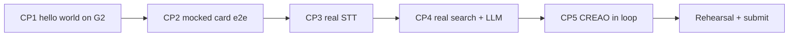

# 04 - Build Plan

Status: draft, Sat Oct 17 2026, afternoon. Owners: Person A (glasses app), Person B (backend + agents). Readers: teammates and coding agents.

## 1. Overview

We have about 21 hours, from Saturday ~3 PM to the submission deadline. Unverified: the deadline is Sunday 12:00. Confirm it at the 3-4 PM workshop or the help desk.

The plan builds the live moment first and adds real services one at a time. Each step ends at an **integration checkpoint** where both halves run together. If a checkpoint slips, we use the cut lines in section 6. We never cut the G2 app or CREAO.

| Person | Owns | Main folders |
|---|---|---|
| A | Glasses app: render contract, states, input, push-to-talk audio, laptop mirror, Even Hub build | `app/` |
| B | Backend on Vultr: API, store, STT, search, LLM, CREAO agents and webhooks, setup page | `backend/`, `agents/` |
| Both | `shared/types.ts`, demo event data, README, rehearsal | `shared/`, `design/` |

**Contract first.** Both people code against `shared/types.ts` and the endpoints in 01 section 4. Until the backend is live, Person A uses a mock that returns a fixed `Brief`.

## 2. Timeline and milestones

| Milestone | Window | Checkpoint (both must pass) |
|---|---|---|
| M0 Setup | Sat 3:00-5:00 PM | CP1: hello world on G2 |
| M1 Mocked loop | Sat 5:00-8:00 PM | CP2: mocked card end to end |
| M2 Real voice | Sat 8:00-10:00 PM | CP3: real STT |
| M3 Real brief | Sat 10:00 PM-1:00 AM | CP4: real search + LLM |
| Sleep | Sat 1:00-7:00 AM | Event Loader run finishes overnight |
| M4 Agents in loop | Sun 7:00-9:00 AM | CP5: CREAO in the loop |
| M5 Polish + extras | Sun 9:00-10:30 AM | Goal switch, Sentry, Photon if time |
| M6 Freeze + submit | Sun 10:30-11:45 AM | Rehearsal passes; submitted by 11:45 |

**Code freeze is Sunday 10:30 AM.** After that, only bug fixes found in rehearsal.



## 3. Ordered task list

Do tasks in order within each column. IDs are referenced in commits (for example `A3: listening state`).

### Person A: glasses app

| ID | Task | Done when |
|---|---|---|
| A0 | Attend workshop 3-4 PM. Ask the questions in section 10 and the README "Open questions". | Answers written into this doc's open questions |
| A1 | (The `everything-evenhub` Claude Code plugin is installed: use its `template --asr`, `glasses-ui`, `handle-input`, `device-features`, `font-measurement`, `test-with-simulator` and `build-and-deploy` skills for A1-A12.) Scaffold `app/` from the `asr` template (`npx degit even-realities/evenhub-templates/asr app`), Even Hub SDK 0.0.16. `app.json`: `name: "Cue"`, `package_id` lowercase reverse-DNS with no hyphens or underscores (e.g. `com.cuehq.cue`), `edition: "202601"`, `version: "0.1.0"`, `permissions` array with `{ name: "network", whitelist: ["https://<backend host>"] }` and `{ name: "g2-microphone" }`, each with a `desc`. No other permissions (unused ones are flagged at review). | `npm run dev` loads in the Even app WebView on the phone |
| A2 | Startup page: three containers `hdr`, `body`, `foot` per 02 section 2; `render(screen)` with `textContainerUpgrade` | **CP1:** text "Cue hello" visible on the physical G2 |
| A3 | Hardware probes: 60-char ruler, `textColor` 1-4 readability, long press, swipe without overflow | Results recorded in 02 section 8; `PTT_MODE` chosen |
| A4 | State machine (02 section 5) with Ready, Card, Quiet, Error; tap and swipe flip cards; double tap opens exit dialog; first-run instructions | All states reachable with a hard-coded `Brief` |
| A5 | `api.ts` client calling `POST /api/briefs/text`; Thinking state | **CP2:** typed text on the setup page or a debug button produces cards on G2 from the backend mock |
| A6 | Laptop mirror: the WebView renders the same `Screen` as HTML | Mirror matches the HUD text for every state |
| A7 | Push-to-talk: `audioControl(true)`, buffer PCM, stop on release / tap / 8 s (plus 300 ms tail), discard clips under 0.4 s, `POST /api/stt` with raw PCM, show `Heard:`, then `POST /api/briefs/text` with the transcript | **CP3** with B4 |
| A8 | Confirm-person state and org-only mode | Ambiguous fixture shows picker; Neither gives org-only cards |
| A9 | Poll `GET /api/briefs/:id?since=` every 5 s while a brief is open; show `★ updated` without jumping cards | **CP5** with B8 |
| A10 | Menu items (02 section 3), goal switch calls `PUT /api/goal`, card 3 shows `updating...` | Goal switch changes card 3 on G2 |
| A11 | Background/resume: save state to `localStorage` on every change; idempotent foreground handlers (02 "Background and resume"). Then, if time: offline org cards from cached `/api/state` | Opening and closing the menu does not change state; killing wifi shows the offline message (and cached org card if built) |
| A12 | Even Hub build (Private or Beta, per workshop answer) installed on the demo phone | App launches from Even Hub, not dev server, on G2 |

### Person B: backend and agents

| ID | Task | Done when |
|---|---|---|
| B0 | Reconcile types: copy the canonical types into `shared/types.ts` (see section 8) | Both sides import it; it compiles |
| B1 | Scaffold `backend/` (Node, Express, TS, SQLite, zod). Deploy to Vultr with HTTPS. HTTPS needs a hostname: use the GoDaddy domain if claimed in the first hour, else `<vultr-ip>.sslip.io`, with Caddy for automatic TLS. This hostname goes into the app.json whitelist and cannot change after A12 without a new build. Set CORS per 01 section 6 and log the WebView `Origin` | `GET /api/state` returns JSON over HTTPS from the phone |
| B2 | Mock `POST /api/briefs/text` returning the Scenario A brief from 02 section 6 | **CP2** with A5 |
| B3 | Create the three CREAO agents in the CREAO UI from `agents/*.md`; get API key; trigger one run by curl | A `run_id` and `usage.credits` recorded |
| B4 | `POST /api/stt`: wrap PCM in WAV, Deepgram with keyterms from the event store, transcript parser (01 section 5), Groq fallback | **CP3:** speaking on G2 shows `Heard: ...` correctly 4 of 5 times |
| B5 | Store: `backend/data/demo-event.json` holds the Event Loader *input* (org names, people, source text). Load the Event Loader *output* from B3's run into SQLite (hand-written orgs only if CREAO is down). Org lookup by exact, alias, then fuzzy; first-name expansion | `"anduril industries"` finds Anduril |
| B6 | Search: two parallel Exa calls, LinkedIn filter, name AND org filter, `sourceKind` classifier, Tavily fallback | Unit tests pass on saved Exa fixtures |
| B7 | Fast LLM brief writer (prompt in `agents/fast-brief.md`), zod validate, safety blocklist, truncate to card limits, template fallback | **CP4:** real names give real cards with source lines in under 5 s from text input |
| B8 | CREAO slow path: start Person Researcher after a `high` brief or a Confirm pick (once per person, 01 section 8), webhook at `/webhooks/creao`, dedupe, chain Brief Writer, store Brief v2; polling fallback | **CP5:** a run started from a live lookup produces a newer `version` on G2 |
| B9 | `POST /api/events` starts Event Loader; run it Saturday night on the demo event | Store has orgs from CREAO output, not hand-typed |
| B10 | Setup page: paste profile, pick goal, load event, typed lookup box | Profile change visibly changes card 3 |
| B11 | `PUT /api/goal` regenerates card 3 only, no new search | Goal switch returns in under 3 s |
| B12 | `scripts/bench.ts`: 5 calls each to Deepgram, Exa, LLM on venue wifi | Real numbers written into 01 section 3.2 |
| B13 | Sentry: tracing spans (stt, lookup, search, llm) + logs; never log audio | Trace for one lookup visible in Sentry |

### Shared tasks

| ID | Task | Owner | Done when |
|---|---|---|---|
| S1 | Pick 3-5 consenting demo people with public bios; write `demo-event.json` and wearer profile | Both, by Sat 9 PM | Each person gives a high match on real search |
| S2 | README: what Cue is, setup, agent IDs, CREAO run share link, privacy notes | B drafts, A reviews | All sponsor requirements in section 7 checked |
| S3 | Demo video backup (in case live fails) | A | 2-minute screen + glasses recording saved |

## 4. Integration checkpoints

| CP | Target time | Pass test | If it fails |
|---|---|---|---|
| CP1 Hello world on G2 | Sat 5:00 PM | Text appears on physical glasses from our app | Venue wifi may isolate clients: switch phone and laptop to a phone hotspot, allow node in the macOS firewall, set `server.host: true`. Then ask Even mentors immediately; this blocks the main track |
| CP2 Mocked card e2e | Sat 8:00 PM | Glasses fetch the mock brief over HTTPS from Vultr and flip 3 cards | Run backend on laptop with a tunnel; fix Vultr later |
| CP3 Real STT | Sat 10:00 PM | Hold, say "Priya, Anduril, recruiter", HUD shows correct `Heard:` line | Use `tapToggle` mode; use menu Talk; last resort the typed lookup on the setup page |
| CP4 Real search + LLM | Sun 1:00 AM | 5 demo people give correct cards with sources; median under 5 s | Show org card first, then full brief; switch Exa to `instant` |
| CP5 CREAO in loop | Sun 9:00 AM | Event Loader built the store; a Person Researcher run updates a brief on G2 | Show CREAO run on laptop and the store it built; keep fast path |

## 5. Repo layout

```
cue/
  README.md                 # submission README (sponsor requirements)
  design/                   # these docs
  shared/
    types.ts                # canonical types used by app and backend
  app/                      # glasses app (Person A)
    app.json                # name "Cue", permissions, network whitelist
    index.html              # also the laptop mirror view
    src/
      main.ts               # SDK bridge init, startup page
      render.ts             # Screen -> textContainerUpgrade
      states.ts             # state machine
      input.ts              # tap, swipe, long press, menu
      ptt.ts                # audio capture and PCM buffer
      api.ts                # backend client
      mock.ts               # fixed Brief for offline dev
  backend/                  # server (Person B)
    src/
      server.ts             # Express app, routes, CORS, auth
      stt.ts  search.ts  llm.ts  store.ts  creao.ts  safety.ts
      setup/                # setup page (static HTML)
    data/demo-event.json
    test/fixtures/          # saved Exa and LLM responses
  agents/                   # prompts, versioned in git
    event-loader.md  person-researcher.md  brief-writer.md  fast-brief.md
  scripts/
    bench.ts                # latency benchmark
```

Secrets live only in `backend/.env` (gitignored) and on Vultr. Commit `backend/.env.example` with key names only: `DEEPGRAM_API_KEY`, `GROQ_API_KEY`, `EXA_API_KEY`, `TAVILY_API_KEY`, `LLM_API_KEY`, `CREAO_API_KEY`, `CREAO_EVENT_LOADER_ID`, `CREAO_PERSON_RESEARCHER_ID`, `CREAO_BRIEF_WRITER_ID`, `PUBLIC_BASE_URL`, `DEVICE_TOKEN`, `SENTRY_DSN`. The app reads `VITE_BACKEND_URL` and `VITE_DEVICE_TOKEN` from `app/.env` (not a secret key, see 01 section 4).

## 6. Cut lines (in order)

Cut from the top when a checkpoint is more than one hour late.

| Order | Cut | Trigger | What we lose |
|---|---|---|---|
| 1 | Photon iMessage follow-up | Default: not started before CP5 | Add-on prize |
| 2 | Sentry (B13) | CP4 later than Sun 2 AM | Add-on prize; latency measured with logs instead |
| 3 | MLH extras (GoDaddy domain if not already in the whitelist; keep Vultr hosting and whatever hostname the build already uses) | CP5 later than Sun 9:30 AM | MLH extras |
| 4 | Fallback providers (Groq, Tavily), offline cached org cards (A11 second half), laptop `/mirror` page (only needed if phone screen mirroring fails) | Any checkpoint more than 1 hour late | Resilience only; demo path unchanged |
| 5 | Goal switching (A10, B11) | Sun 10:00 AM with CP5 not passed | Demo goal-switch beat; replace with setting the goal on the setup page before the demo |
| Never | G2 app, CREAO agents | | |

## 7. Test plan

**Unit tests (backend, `npm test`)**
- Safety filter drops blocklisted facts and any `linkedin.com` source.
- Disambiguation keeps only results that mention name AND org (or alias).
- Card truncation: body at most 200 characters, 5 lines, 40 characters per line, ASCII plus safe glyphs.
- CREAO `result.text` parser handles bare JSON and JSON inside code fences.

**Fixture tests**
- Typed lookups for every demo person, one unknown name, one ambiguous name, and one unknown org. Check match level and which cards come back.

**Hardware checklist (on G2, before freeze)**
- First-run instructions show once.
- Every state has a visible line; never black.
- Double tap opens exit dialog from every state.
- Boot console is clean.
- Long press (or fallback) works 5 of 5 times.
- Mirror matches HUD.

**Latency**
- `scripts/bench.ts` on venue wifi, plus 10 spoken lookups on G2. Record the median time from release to card 1.

**Failure drills**
- Wifi off: offline message and cached org card.
- Unknown name: org-only card with "No public info found".
- Kill the LLM key: template org card.

**Demo rehearsal (3 full runs, Sun 10:30-11:15 AM)**
- At a real table with noise, using the exact script below, timed.
- Pass: under 2:10, every beat works, no restart. Fix only what failed.

### Sponsor requirement check

| Sponsor | Requirement | Where |
|---|---|---|
| Even Realities | Even Hub build on physical G2, app name `Cue`, review hygiene | A12, hardware checklist |
| CREAO | Agent IDs + run share link in README; agent shown running in demo | S2, B8, demo beat 5 |
| Sentry | At least 2 products beyond errors (tracing + logs) | B13 |
| MLH | Vultr hosting, GoDaddy domain | B1 |

## 8. Doc conflicts to resolve in B0

The earlier drafts disagreed in these places. The docs have been edited to match the "Use" column; if you still find a mismatch, this table wins:

| Topic | Conflict | Use |
|---|---|---|
| Card body limit | 200 (02), 220 (03), 280 (01) | 200 characters, 5 lines of 40 (display is the hard limit). Title 20. `source` is a bare domain/path, max 34; the app adds `src: ` |
| Type shapes | `Brief`, `Person`, `Organization` differed between 01 and 03 | 01 section 5 is canonical (now includes `Fact`, `SourceKind`, `oneLiner`, `focusNow`). 03 points to it |
| Webhook path | `/webhooks/creao` (01) vs `/creao/webhook` (03) | `/webhooks/creao` |
| Match rules | Stored person = high (01) vs 2+ results = high (03) | High if stored person or 2+ kept results about one person; medium if exactly 1, or 2+ different full names, or first name not expandable; low if 0 |
| Medium match UX | confirm prompt (00, 03) vs picker only for 2+ (02) | Every medium match shows the Confirm picker (1-3 candidates plus Neither) |
| Low match / Neither | 1 org card (00, 01, 03) vs 3 org-only cards (02) | One `context` card about the org, body starts `No public info found for <name>.` (or `<name> not confirmed.` after Neither) |
| Audio endpoint | `POST /api/briefs` with PCM (01) vs `POST /brief` with WAV (03) | `POST /api/stt` (PCM in, transcript out), then `POST /api/briefs/text` |
| Tap-toggle input | double-click toggle (00) vs tap toggle (02) | Tap toggle; double-click is always exit |
| Auto-quiet timeout | 20 s (00) vs 25 s (02) | 25 s, tune on hardware |
| CREAO polling | after 10 min (01) vs every 15 s (03) | Every 15 s while pending; fail after 15 min |

## 9. Two-minute demo script

Setup: glasses on Person A, phone mirrored to the laptop facing judges, CREAO console open in a second tab. Goal set to Internship. The demo person has consented and is in the preloaded event.

| Time | Beat | Who says / does what | Judges see |
|---|---|---|---|
| 0:00-0:15 | Problem | B: "At a career fair you meet 30 people in 2 hours. You forget who does what, and small talk wastes the moment." | Title on laptop |
| 0:15-0:25 | Setup | B: "Last night a CREAO Event Loader agent loaded every sponsor at this event. Person A's goal today is an internship." | Setup page with event loaded |
| 0:25-0:50 | Live moment | A reads the rep's badge, holds the temple, quietly says "Name, Org, role". | Mirror: Listening, Thinking, `Heard:` line, card 1 with source |
| 0:50-1:10 | Flip cards | A taps through Connect, Context, Your angle and opens with the Connect line. | Three cards on mirror |
| 1:10-1:20 | Quiet | A keeps talking with the rep. | HUD drops to one dim status line |
| 1:20-1:35 | Agents | B: "Meanwhile a CREAO Person Researcher is digging deeper." Shows the run this lookup just started in the CREAO console (before the demo, clear the demo person's `lastResearchedAt` so the once-per-person rule starts a fresh run), then a completed run for this person from rehearsal and the deeper brief it produced. CREAO runs take minutes, so do not wait for `★ updated` on stage. | Run in progress; a finished run and its v2 cards |
| 1:35-1:50 | Goal switch | A picks `Goal: Cofounder` from the menu. | Card 3 changes; cards 1-2 stay |
| 1:50-2:00 | Close | B: "Real web search, public professional info only, no camera, no recording. That's Cue." | Privacy line on laptop |

Honesty line if asked: "Person lookup is real web search. We preloaded the demo event with people who have public bios."

## 10. Open questions

- Unverified: submission deadline (believed Sun 12:00).
- Unverified: Private build vs Beta build for the Even track.
- Unverified: CREAO developer API key on our plan, credits per run, and the share link format judges want.
- Which fast LLM, and whose account pays.
- Who are the consenting demo people, and when do we ask them?
